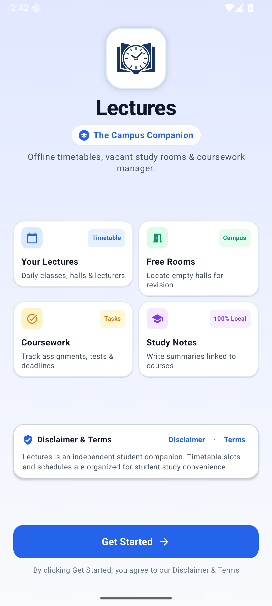
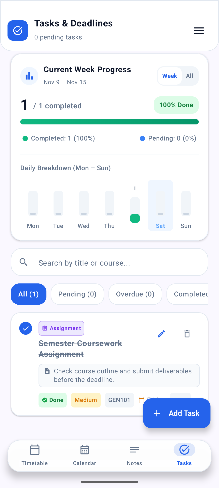
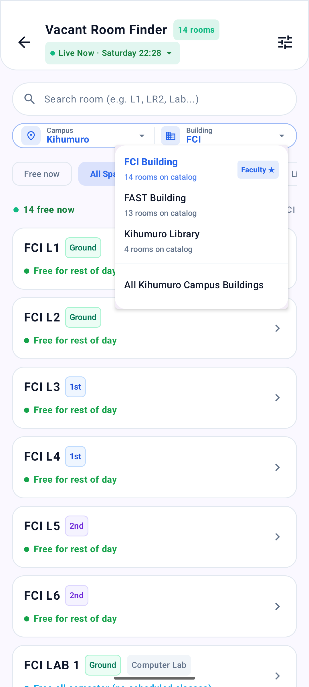

# Lectures

**An offline-first Android academic companion for MUST students — timetable, notes, deadlines, alarms, and a live campus vacant-room finder.**

[](https://github.com/mugmarp/mylectures-2/actions/workflows/android-ci.yml)
[](https://developer.android.com/)
[](https://kotlinlang.org/)
[](https://developer.android.com/jetpack/compose)
[-orange.svg)](https://developer.android.com/training/data-storage/room)
[](#privacy)

---

## Why this exists

MUST publishes its timetables online at [timetable.must.ac.ug](https://timetable.must.ac.ug) — teaching timetables, room allocations, and examination schedules. The data is public and current, and it is listed on the university's own [digital systems directory](https://systems.must.ac.ug).

But it is published as **one large HTML table per programme**, and a separate set of tables **per room**. Answering a simple question — *"what do I have next, and where can I sit down?"* — means finding your programme's table, scanning it, then cross-referencing the room tables to work out what's free. On a phone, and often on a slow connection.

So in practice, most students never open it. Instead the timetable gets re-shared into WhatsApp class groups and pinned there — a screenshot or export of your own section's table, which is faster to glance at than the real source. It works, but it is a convenience copy: it lives in a chat thread, it goes stale when the timetable is revised, and it tells you nothing about rooms.

The university's official **Pulse** app covers a lot of ground — timetable, attendance tracking, announcements, campus maps, academic calendar — but it is credential-gated and server-backed, so it answers nothing without a connection.

That leaves a narrow but real gap:

**your own schedule, on your device, with no login and no signal — and a direct answer to which rooms are free right now.**

Lectures fills it. Your timetable is stored locally, works fully offline, and cross-references every room's bookings to show what's vacant before you start walking.

---

## How this differs from the official Pulse app

MUST has an official app — **Pulse** ([Android](https://play.google.com/store/apps/details?id=com.kuyeso.mustapp) / [iOS](https://apps.apple.com/us/app/mbarara-university/id6752959871)) — and it is good at what it does. Lectures is not a replacement for it, and does not try to be.

| | **Pulse** (official) | **Lectures** |
|---|---|---|
| Timetable | ✅ | ✅ |
| Academic calendar | ✅ | ✅ |
| Announcements & news | ✅ | — |
| Attendance tracking (location-verified) | ✅ | — |
| Campus maps & navigation | ✅ | — |
| Student services / support tickets | ✅ | — |
| Sign-in required | University credentials + biometrics | **none** |
| Works offline | Server-backed | **yes, fully** (timetable ships in the app) |
| Per-class notes | — | ✅ |
| Assignment & deadline tracking | — | ✅ |
| Exact background alarms | — | ✅ |
| **Vacant room finder** | — | ✅ |
| Analytics / tracking | (see its policy) | **Pseudonymous install diagnostics only** (no ads / third-party analytics SDKs) |

**The two real differences:** Pulse needs a login and a connection; Lectures needs neither. And Pulse does not answer *"which room is free right now?"*

If you want announcements, attendance, or campus maps — use Pulse. If you want your schedule to work on a bad connection, and to stop walking between buildings looking for a seat — that is what Lectures is for.

---

## Features

### 📅 Timetable that works offline
The full semester timetable is bundled in the app, so it is available the moment you install it — no download, no login, no signal. Seven-day schedule with a live "Happening Now" tracker: real-time progress bar, elapsed and remaining minutes, and a countdown to the next class. Full support for specialized curriculum tracks (BS combinations, HEAP certificates, DLT, BBA, and BPCD), uncluttered shared class indicators, and pre-class reminder alarms.

### 👁️ Preview Mode
Temporarily inspect any other academic class, year, or track without altering your official enrollment. A persistent status banner keeps you informed while your background alarms remain securely locked to your enrolled schedule.

### 🏫 Vacant Room Finder
Derived from the university's own room allocation data: **93 rooms across 7 buildings and 2 campuses**.

- Campus filter (Kihumuro / Town) — they're 7 km apart, so this matters
- Building filter (FCI, FAST, Kihumuro Library, Science Block, Pharmacy, IMS, Clinical)
- Minimum study-gap filter, so you're not sent to a room that frees up for one minute
- "Free until 14:30" — tells you when the next class arrives, not just that it's empty now
- Ranked by usefulness: lecture rooms and labs first, libraries last (you already know the library is free)

### 📝 Obsidian-Grade Lecture Notes
Distraction-free Markdown editor equipped with an Obsidian-style reading and editing experience, scaling from focused mobile editing to a 3-zone desktop workspace:
- **Live Preview Syntax Highlighting**: Real-time syntax coloring inside the editor for headers, bold, italics, code, strikethrough, highlights, and WikiLinks.
- **3-Mode Desktop Split Workspace**: Switch cleanly between `Split` (side-by-side live editor & preview), `Write`, and `Preview` with a docked Inspector pane on wide screens (`>= 960dp`), keyboard shortcuts (`Ctrl+B/I/S`), and internal `files/attachments/` file persistence.
- **Obsidian Callouts & Admonitions**: Styled cards for `> [!NOTE]`, `> [!TIP]`, `> [!IMPORTANT]`, `> [!WARNING]`, `> [!DANGER]`, and `> [!SUCCESS]`.
- **Formatted Tables & Math Equations**: Alignment-aware tables (`| Header |`) and LaTeX-style math formulas (`$inline$` and `$$block$$`).
- **Smart Formatting**: Text highlights (`==key term==`), internal WikiLinks (`[[Course Unit]]`), smart Enter continuation for checklists and lists, Cornell note-taking template, and 1-tap copyable code blocks.
- **Course & Class Linking**: Attach notes to specific lectures or course codes with pre-class alarms.

### 📱 Adaptive Phone, Foldable, Tablet & Desktop Shell
- **Responsive Breakpoints (`Chrome.kt` + `LocalLecturesWindow`)**: Switches automatically from the floating mobile bottom pill dock (`< 600dp`), to a leading `NavigationRail` (`600–1199dp`), to a collapsible `228dp` `ExpandedSidebar` (`>= 1200dp`), propagating pane-accurate widths so split views adapt gracefully alongside the sidebar.
- **Multi-Pane Workspaces**: Master-detail / split workspaces across Timetable, Notes, Calendar, Tasks, Settings, and a 3-pane Vacant Room Finder, plus desktop hover states and `Ctrl+1..6` / `Ctrl+,` keyboard navigation.

### 🎨 Unified Appearance & Notifications
- **Single Appearance & Theme Hub (`Settings → Appearance & Theme`)**: Choose `Light`, `Dark`, or `System` mode alongside 5 curated accent palettes (*Royal Blue*, *Emerald*, *Violet*, *Amber*, *Ocean Teal*) with a live WCAG-checked preview card.
- **Flexible Reminder Controls**: Configure pre-lecture and task deadline lead times, a daily 7:30 AM Morning Schedule Digest, exact-alarm health diagnostics, and Android channel sound profiles.

### ✅ Tasks & deadlines
Assignments organized across Urgent / High / Medium / Low priority with completion toggles, deadline alarms, read-only enrolled course dropdowns, and an interactive weekly progress dashboard with daily breakdown stacked charts.

### 📆 Academic calendar
Merges your timetable with personal study activities into one day view, with a month grid, dot matrices, semester milestones roadmap, and quick "today" jump.

### ☁️ Google Cloud Backup, Export & Feedback
100% functional offline by default in Guest mode. Optional Google Sign-In via Jetpack Credential Manager allows students to back up and sync their notes, coursework tasks, and schedule preferences across devices with bidirectional conflict resolution, guest-to-UID ownership isolation, offline JSON export backups, and an offline-queued anonymous feedback sheet.

### 🔄 Play-Compliant Release Checks
Lectures periodically checks verified release metadata (`version.json` and GitHub Releases API with 15-minute caching), enforces HTTPS URLs and semantic-version downgrade protection, displays concise release highlights, and opens the official GitHub Releases page in the browser via `Intent.ACTION_VIEW` (no `REQUEST_INSTALL_PACKAGES` permission).

---

## Screenshots

| Welcome | Timetable | Tasks | Vacant Rooms |
|---|---|---|---|
| [](docs/screenshots/Lectures_welcome_screen.png) | [](docs/screenshots/BSE_II_timetable%20screen.png) | [](docs/screenshots/tasks_screen.png) | [](docs/screenshots/room_finder_at_kihumuro.png) |
| *Welcome & feature overview* | *BSE II schedule & Next Up card* | *Week progress & deadlines* | *Kihumuro campus, FCI Building* |

**[View all 11 screenshots →](docs/SCREENSHOTS.md)**

---

## Privacy

**Local-first. No accounts. Pseudonymous diagnostics only.**

Everything that matters — timetable, notes, tasks, alarms, preferences — is stored in a private SQLite database on your device and works with no connection.

The only data that leaves the device is **pseudonymous technical diagnostics**: an anonymous installation UUID, device model, Android version, launch count, and enrolled programme. This helps maintain timetable reliability across MUST cohorts. No names, emails, phone numbers, or note contents are ever collected, transmitted, or sold.

### What is NOT collected
- No Firebase Analytics, Google Analytics, AdMob, Crashlytics, Facebook, Sentry, Amplitude, Mixpanel, AppsFlyer, Adjust, Bugsnag, or New Relic — all absent from the APK
- No behavioural tracking of feature usage or screen views
- No advertising or data harvesting
- No personal identity of any kind

### Network behaviour, precisely

| | Status |
|---|---|
| Analytics / advertising SDKs | **None packaged** — Firebase Analytics, Google Analytics, AdMob, Crashlytics, Facebook, Sentry, Amplitude, Mixpanel, AppsFlyer, Adjust, Bugsnag, New Relic all absent from the DEX |
| Accounts or sign-in required | **No** |
| Network requests | **Yes** — pseudonymous diagnostics to Firestore `/user_telemetry/` and `/feedback/` collections; no behavioural or advertising tracking |
| Works with no connection | **Yes** — the timetable ships in the APK and the app is fully functional offline |

**Firebase SDKs are bundled in the APK** — `firebase-common`, `firebase-firestore`, `firebase-auth`, `firebase-appcheck`. Since `startTimetableSync()` runs at app launch and `AnalyticsManager` writes telemetry on first use, network requests **are** made. The data sent is limited to:

- Anonymous installation UUID (no IMEI, MAC, or account linkage)
- Device model and Android OS version
- Launch count and enrolled programme code
- Aggregate feature usage counters

No names, emails, phone numbers, note contents, or personal data of any kind is collected without explicit consent. The `INTERNET` and `ACCESS_NETWORK_STATE` permissions exist solely for timetable metadata updates, pseudonymous service diagnostics, anonymous feedback, and optional Google account cloud backup.

### Permissions

| Permission | Why |
|---|---|
| `POST_NOTIFICATIONS` | Ring class and deadline reminders |
| `SCHEDULE_EXACT_ALARM` | Fire them on time, even in Doze mode |
| `RECEIVE_BOOT_COMPLETED` | Re-arm alarms after a restart |
| `WAKE_LOCK` | Deliver an alarm while the device is asleep |
| `VIBRATE` | Alarm vibration |
| `INTERNET`, `ACCESS_NETWORK_STATE` | Required for timetable sync, anonymous feedback, and optional Google cloud backup |

---

## Architecture

Clean MVVM with unidirectional data flow. Jetpack Compose UI, `StateFlow` state, Room as the single source of truth.

```
        Jetpack Compose UI
   (Timetable · Calendar · Notes · Tasks · Rooms)
                 ▲ │
     StateFlow   │ │  user events
                 │ ▼
             ViewModels
                 ▲ │
   Coroutines /  │ │  suspend + Flow
   Flow          │ ▼
        TimetableRepository
        (single source of truth)
                 │
        ┌────────┴────────┐
        ▼                 ▼
   Room (SQLite)     AlarmManager
   offline store     exact alarms
```

Room DAOs return `Flow<List<T>>`, so any write propagates to the UI without manual re-querying.

### Performance notes

- No `IntrinsicSize.Min` inside `LazyColumn` items — accent bars use `Modifier.matchParentSize()` for single-pass layout
- No full-screen pointer interceptors over vertical scrollers
- Stable keys on every lazy list item
- Expensive date/format work memoised with `remember`

---

## Tech stack

| Layer | Choice |
|---|---|
| Language | Kotlin 2.2 |
| UI | Jetpack Compose + Material 3 |
| Architecture | MVVM + UDF |
| Persistence | Room (SQLite), DataStore for preferences |
| Background | `AlarmManager` (exact, Doze-resilient) + `BootReceiver` re-arming |
| Build | Gradle 9.3.1, AGP 9.1.1, KSP |
| Min / Target SDK | 26 (Android 8.0) / 35 (Compile SDK 36) |
| CI | GitHub Actions — compiles, assembles, tests, uploads APK |

---

## Project structure

```
app/src/main/java/com/lectures/
├── MainActivity.kt
├── TimetableApplication.kt        DI wiring, Room v12 init, WorkManager, App Check
├── core/
│   ├── alarm/                     schedulers, receivers, boot re-arm, sync coordinator
│   ├── analytics/                 pseudonymous telemetry & crash-safe prefs
│   ├── auth/                      Credential Manager Google Sign-In & Firebase Auth
│   ├── database/                  AppDatabase (v12), DAOs, migrations, converters
│   ├── network/                   Firebase factory (Firestore, Auth, App Check)
│   ├── notification/              notification channels, digests & in-app alert store
│   ├── storage/                   AttachmentStore (internal files/attachments/)
│   ├── sync/                      Firestore bidirectional sync & SyncConflictResolver
│   ├── update/                    HTTPS release checker & AppUpdateDialog
│   └── util/                      TimeUtil, academic week, permission & export helpers
├── features/
│   ├── account/                   Google Account & Cloud Backup management screen
│   ├── calendar/                  month grid, milestones roadmap + day agenda
│   ├── developer/                 developer profile modal
│   ├── feedback/                  anonymous feedback sheet & offline retry queue
│   ├── notes/                     Obsidian markdown engine, Split/Write/Preview & inspector
│   ├── onboarding/                faculty → programme → class group flow
│   ├── rooms/                     RoomDirectory (93 rooms) + 3-pane VacantRoomsScreen
│   ├── settings/                  dual-pane Settings, Appearance & Theme, Notifications
│   ├── tasks/                     priorities, deadlines, dashboard
│   └── timetable/                 domain, repository, DataLoader, adaptive workspace UI
└── ui/                            Chrome, MainScaffold, Theme, AdaptiveNavigationShell
```

---

## Building

### Prerequisites
- JDK 17 or 21
- Android SDK, platform 36
- Gradle 9.x

### Commands

```bash
# Compile Kotlin only (fastest feedback)
gradle :app:compileDebugKotlin

# Build debug / minified release APKs
gradle assembleDebug
gradle :app:assembleRelease

# Run JVM, Robolectric, Compose UI, Play Policy & Build Hardening tests
gradle :app:testDebugUnitTest

# Verify Roborazzi visual snapshots across phone, tablet & desktop viewports
gradle :app:verifyRoborazziDebug

# Full check (lint + tests)
gradle check
```

> The repository does not track the Gradle wrapper (`gradlew`); use `gradle` directly.

### CI

Every push to `main` runs [`.github/workflows/android-ci.yml`](.github/workflows/android-ci.yml): Kotlin compile, debug and release APK assembly, unit tests, and artifact uploads. The release APK is ~18 MB (the debug APK is ~27 MB).

The workflow generates a throwaway debug keystore, since `debug.keystore` is gitignored. The release signing config falls back to the debug keystore when no upload key is present, so CI produces a signed release APK.

`google-services.json` is injected from a GitHub Secret (`GOOGLE_SERVICES_JSON`) at build time. It is gitignored and never committed.

---

## Data sources

Timetable and room data come from the university's public timetable pages:

- `index_teaching.html` — one table per programme (1,348 entries)
- `index_rooms_teaching.html` — one table per room (93 rooms catalogued across 7 buildings)

Room campus assignment is **derived from the faculties of the cohorts that actually use each room**, not guessed from room names.

### How updates & backups reach the app

**Offline-first snapshot + automatic background & cloud sync.** The dataset ships bundled in the APK (`mustime_prepopulated.db` / `timetable_export.json`) and loads locally on first launch.

1. **On launch & background worker** — `startTimetableSync()` observes the central `/timetable` and `/timetable/metadata` Firestore documents, while `TimetableSyncWorker` schedules periodic 24-hour timetable syncs and 36-hour throttled release checks.
2. **Manual refresh** — **Settings → Data & Synchronization → Sync Now** refreshes live Firestore schedule metadata on demand, falling back cleanly to local Room storage when offline.
3. **Anonymous feedback & offline queue** — Feedback submissions timeout-guard network writes and persist unsent entries in an offline retry queue (`pending_feedback_retry_queue`) for automatic retry on next launch.

### Cloud Backup & Synchronization

Students can optionally link their Google Account (via Jetpack Credential Manager) under **Account & Cloud Backup** (accessible from Settings or the adaptive desktop sidebar). Coursework notes, assignments, calendar events, and preferences synchronize bidirectionally with Firestore using `ownerId` tenant isolation, `SyncConflictResolver` draft preservation on conflicting notes, and offline JSON export backups.

---

## Documentation

| Guide | Covers |
|---|---|
| [Architecture](docs/ARCHITECTURE.md) | Layers, threading, data lifecycle, design decisions |
| [Features](docs/FEATURES.md) | Every screen and behaviour |
| [Database Schema](docs/DATABASE_SCHEMA.md) | Room entities, indexes, DAOs |
| [User Guide](docs/USER_GUIDE.md) | Walkthrough for students |
| [Developer Guide](docs/DEVELOPER_GUIDE.md) | Setup, adding faculties/programmes, code standards |
| [Terms & Regulations](docs/TERMS_AND_REGULATIONS.md) | Legal terms and disclaimers |

---

## ⚠️ Not affiliated with MUST

**Lectures is an independently developed student utility.** It is **not** an official product of, endorsed by, sponsored by, or affiliated with Mbarara University of Science and Technology or any of its faculties, departments, or administrative offices.

All university names, faculty titles, and course codes are referenced solely to describe and categorise schedules. Trademarks belong to their respective owners.

**Always cross-check the official university sources** — [timetable.must.ac.ug](https://timetable.must.ac.ug) and the [systems.must.ac.ug](https://systems.must.ac.ug) — for announcements, venue changes, and examination timetables or any official communication. The app is provided "AS IS" software, without warranty — the developer `SHALL NOT` be held liable for ANY missed classes, test clashes, or schedule discrepancies.

---

## Developer

**Mark Paul MUGENDAWALA** · [@mugmarp](https://github.com/mugmarp)

---

## License

All rights reserved © 2026.
