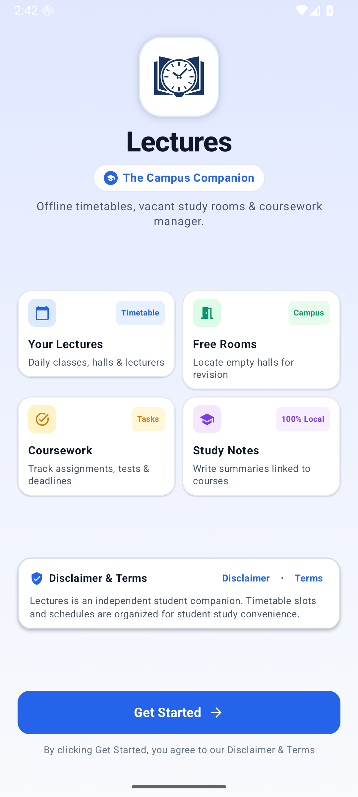
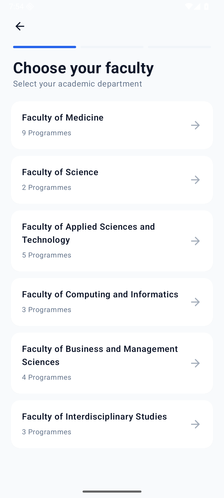
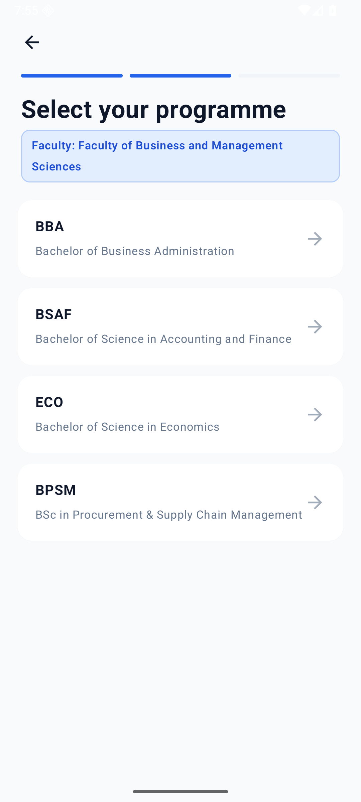
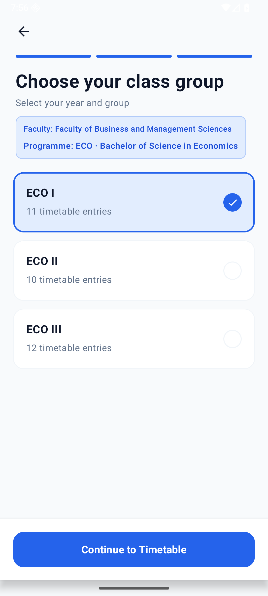
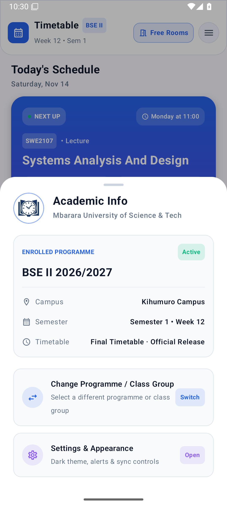
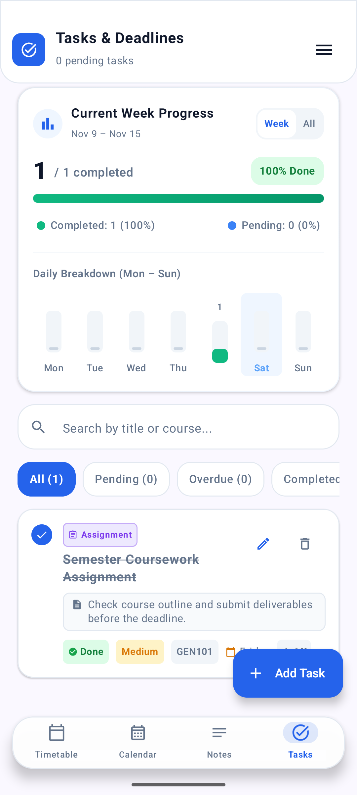
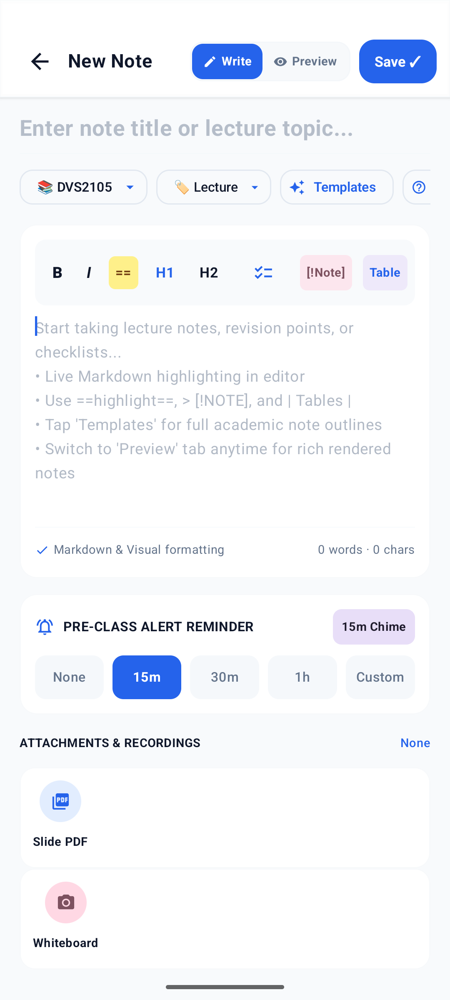
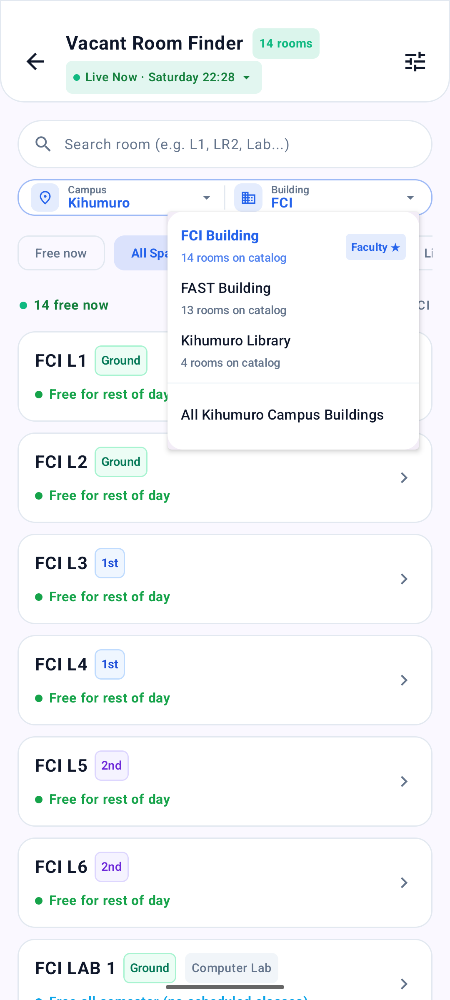
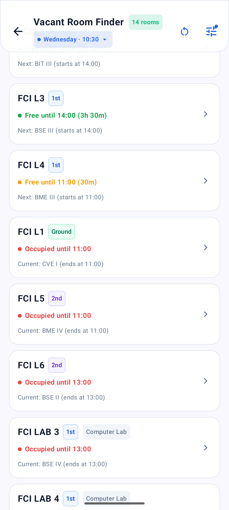
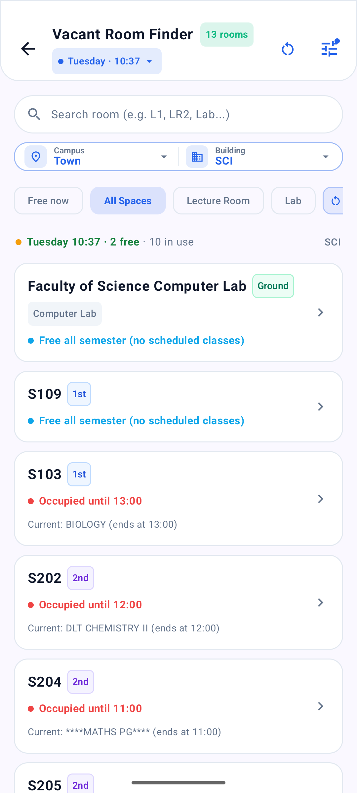

# Lectures — App Screenshots

All screens from the current release, grouped by feature area (previous screenshots are preserved in [`screenshots/legacy/`](screenshots/legacy/)).

## Onboarding

| | |
|---|---|
|  |  |
| *Welcome screen — app identity, feature overview, and onboarding entry point.* | *Faculty selection — step 1 of 3: six faculties with programme counts.* |
|  |  |
| *Programme selection — step 2: degree programmes within the selected faculty.* | *Class group selection — step 3: year group with live timetable entry counts.* |

## Timetable & Profile

| | |
|---|---|
|  |  |
| *Timetable — card-based daily view with a "Next Up" tracker, lecture reminders, and quick note shortcut.* | *Academic Info — enrolled programme (BSE II 2026/2027), Kihumuro campus, Semester 1 Week 12, and timetable release status.* |

## Productivity

| | |
|---|---|
|  |  |
| *Tasks & deadlines — week progress dashboard, daily breakdown, search, and priority filters.* | *Lecture notes — Markdown editor with Write/Preview toggle, highlight/callout/table tools, course linking, templates, pre-class reminders, and attachments.* |

## Vacant Room Finder

| | |
|---|---|
|  |  |
| *Vacant Room Finder — Kihumuro campus, FCI Building selector with 14 rooms and live availability.* | *Vacant Room Finder — Kihumuro campus, FCI Building time-slot preview (Wednesday 10:30) showing free-until windows and occupied classes.* |
|  | |
| *Vacant Room Finder — Town campus, Science Block (SCI) time-slot check (Tuesday 10:37) with free & occupied rooms.* | |
